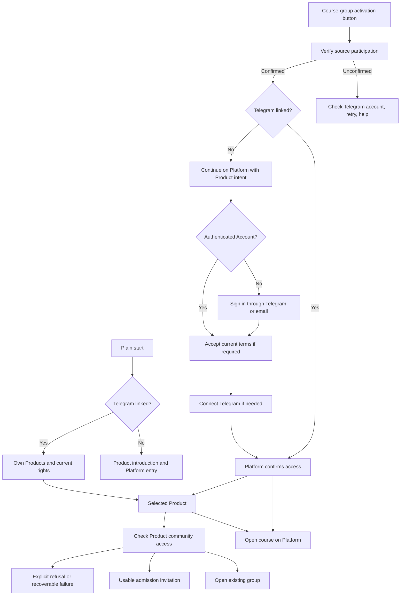

# Telegram learner journeys v1

Status: owner-accepted journey and interface direction, consolidated on 2026-10-15; implementation pending.
This specification defines target behaviour, not current runtime evidence.
Design record: [#1467](https://github.com/sachkov-inside/platform/issues/1467).
Single delivery task: [#1496](https://github.com/sachkov-inside/platform/issues/1496), part of
[#854](https://github.com/sachkov-inside/platform/issues/854).

## Delivery decision

The owner explicitly chose one implementation task and no separate prototype on 2026-10-15.
For this task, the state map and text screens below replace the preparatory prototype stage.
This task-specific owner instruction overrides the separate prototype prerequisite; it does not change the general delivery workflow.
Implement and review the actual bot screens in #1496, including screenshots and interaction evidence.
Do not create another design task, a temporary-UI integration task, or an announcement editor.
This preparation assignment does not start implementation, authorize external messages, or authorize deployment.
Keep #1467 as the design record and #1496 as the sole implementation/release task.

## Problem

A learner can obtain course access, but ordinary bot entry does not reliably expose the next useful action.
Account sign-in and Telegram linking can interrupt the selected Product journey.
Existing members need a direct action to open their Product group.
A normal chat action must return a usable result synchronously instead of requiring a later manual check.

## Outcome and boundaries

The bot handles access activation, own Products, Product community entry, and contextual help.
Platform owns Accounts, sign-in, terms acceptance, and final access decisions.
An ordinary visitor sees brief Product information and a Platform entry without compulsory registration.
A linked learner immediately sees their Products and can open materials or the configured group.
Marketing is a bot responsibility, but funnels and marketing redesign are outside this delivery.
The ordinary-visitor screen is an initial version that the owner expects to revise for marketing.
Future marketing presentation must preserve direct activation and returning-learner paths.

## User stories

1. As an ordinary visitor, I can understand the bot's purpose and open Platform without creating an Account.
2. As an existing email-account holder, I can sign in to that Account and connect Telegram without losing purchases or progress.
3. As a new learner, I can use Telegram sign-in on Platform without supplying email or separately registering.
4. As an authenticated learner, I can connect Telegram without repeating sign-in.
5. As a linked learner, I can immediately select one of my Products in the bot.
6. As an eligible SachkovLearn participant, I can obtain AI Engineering access through the group activation link.
7. As a learner interrupted by sign-in, I return to the selected Product with the verified activation basis preserved.
8. As a learner outside the Product group, I can request and receive a usable invitation within that action.
9. As a current group member, I can open that group directly.
10. As a learner whose rights changed, I can still find the Product and understand materials and group availability separately.
11. As a learner who encounters an error, I can retry the failed action or use contextual help.
12. As a mobile learner, I can finish the same journey inside Telegram's browser without losing Product intent.
13. As an authorized author, I can use the separate «Управление» section.
14. As the owner, I can give the agent announcement text and receive a bot message privately for forwarding to the course group.
15. As a returning learner, repeated links and old buttons preserve my Account and do not duplicate or extend grants.

## Identity and activation contract

Ordinary `/start` creates or reactivates BotContact; it does not create Account.
For access requiring an Account, continue on Platform and skip already completed steps.

| Initial state | Required path |
|---|---|
| No Account | Platform Telegram sign-in creates the Account and completes its Telegram binding. |
| Existing email Account | Sign in to that Account and connect Telegram from it. Keep existing-account entry visible. |
| Authenticated Account without Telegram | Connect Telegram without another sign-in. |
| Telegram already bound | Resolve and reuse that Account. Bot access checks require no repeated sign-in. |

Use the existing terms-acceptance gate for both sign-in methods before completing a binding that requires it.
A Telegram-only Account has no fabricated email. Do not add a second session system or automatic Account merging.
Platform remains the authority for Account resolution; Telegram references are opaque principals.

For SachkovLearn activation, verify source participation and preserve the selected Product and verified basis.
If linking is needed, offer «Продолжить на платформе».
After Platform completes sign-in, required terms acceptance, binding, and the grant, open the Product programme.
Update the bot activation card automatically; «Я привязал Telegram» is not a normal prerequisite.
Never report an Account-scoped grant as complete before Platform confirms it.
Identity conflict stops granting or rebinding; direct the person to the bound Account or help.

Browser sign-in remains bound to the browser where it started.
Telegram's browser may require sign-in even when Safari or Chrome is already signed in.
Do not assume shared cookies or transfer a session through an ordinary URL.
Preserve Product intent through sign-in, binding, expiry recovery, and safe browser return.

## State map

Product names, source groups, destination groups, and rights come from trusted current state.
AI Engineering, SachkovLearn, and Sachkov Inside are the concrete review example.
Several Products can share one actual group without becoming one Product.

## Screens and transitions

Russian text below defines the bot copy. Buttons are separate rows unless a contextual variant is stated.

| ID and state | Russian copy | Buttons and transitions |
|---|---|---|
| B1: ordinary start, unlinked | «Inside\n\nНа платформе доступны продукты и учебные материалы. Войдите и подключите Telegram, чтобы видеть свои продукты и вступать в их группы.» | «Открыть платформу» → sachkov.dev; «Уже есть аккаунт» → Platform sign-in/linking; «Помощь» → H1. |
| B2: linked, Products available | «Мои продукты\n\nВыберите продукт, чтобы открыть материалы или группу.» | One named Product per row → B4; «На платформу» → sachkov.dev; «Помощь» → H1. Authorized authors also see «Управление» → existing author functions. |
| B3: linked, no Products found | «Мои продукты\n\nПока нет доступных продуктов. Посмотрите продукты на платформе. Если у вас есть ссылка для получения доступа, откройте её.» | «На платформу»; «Помощь» → H1. Do not promise an available purchase while public sales remain closed. |
| B4: Product, materials and chat available | «AI Engineering\n\nМатериалы доступны. Вы можете вступить в группу курса.» | «Открыть курс» → selected programme on Platform; «Вступить в группу» → C1; «Помощь» → H1 with Product context; «Назад к продуктам» → B2. |
| B5: Product, already a chat member | «AI Engineering\n\nМатериалы доступны. Вы уже в группе курса.» | «Открыть курс»; «Открыть группу» → actual Product group; «Помощь»; «Назад к продуктам». |
| B6: retained Product, a right unavailable | «AI Engineering\n\nМатериалы: {current availability}.\nГруппа: {current availability and confirmed reason}.» | Keep «Открыть курс» only when materials remain available. Show «Открыть группу» for a current member only when appropriate to the confirmed restriction; do not issue a new invitation without a right. Include «Помощь» and «Назад к продуктам». |
| A1: source verification | «AI Engineering\n\nПроверяем участие в SachkovLearn…» | Replace with A2, A3, A4, or E1 after the check. Never claim access before Platform confirms it. |
| A2: source confirmed, linking needed | «AI Engineering\n\nУчастие в SachkovLearn подтверждено. Продолжите на платформе, чтобы получить доступ к курсу.» | «Продолжить на платформе» → selected Product sign-in/linking continuation; «Помощь» → H1. |
| A3: grant confirmed | «AI Engineering\n\nКурс доступен. Открывайте материалы и присоединяйтесь к группе курса.» | «Открыть курс»; «Вступить в группу» → C1, or «Открыть группу» for an existing member; «Помощь»; «Мои продукты» → B2. For existing members replace the group sentence with «Вы уже в группе курса.». |
| A4: source participation unconfirmed | «Доступ по этой ссылке предназначен для участников SachkovLearn. Не удалось подтвердить ваше участие. Проверьте, что открыли бота тем аккаунтом, которым пользуетесь в группе.» | «Проверить снова» → source verification; «Помощь» → H1. Do not classify provider failure as ineligibility. |
| P1: Platform sign-in | «Войдите, чтобы получить доступ к AI Engineering.» | Reuse Platform Telegram/email sign-in. Make existing email-account entry visible. Preserve Product and activation intent through both methods. |
| P2: authenticated Account needs Telegram | «Подключите Telegram, чтобы получить доступ к AI Engineering.» | Reuse authenticated Account linking. Telegram sign-in skips this step when its binding is already complete. The existing terms gate applies to both sign-in methods before completion, independently of whether P2 is shown. |
| P3: access confirmed on Platform | After any required terms acceptance, completed linking, and confirmed grant, open the AI Engineering programme. | Update the bot's existing activation card to A3 automatically. A manual «Я привязал Telegram» action is not a normal prerequisite. Remain on the course rather than forcing a return to the bot. |
| C1: chat action running | «AI Engineering\n\nПроверяем доступ к группе…» | Complete the requested eligibility and membership checks within the action. Use C2, B5, B6, C3, or E1 as the result. |
| C2: invitation ready | «AI Engineering\n\nМожно вступить в группу курса.» | «Вступить в группу» → usable invitation; «Открыть курс»; «Назад к продукту» → current Product card. Telegram join-request mechanics remain behind the existing admission boundary. |
| C3: moderator restriction | «AI Engineering\n\nВступление в группу ограничено. Напишите в поддержку, чтобы уточнить причину.» | «Написать в поддержку» → @sachkova_mng; «Открыть курс» if allowed; «Назад к продукту». Do not lift moderation restrictions through activation. |
| E1: provider failure or ten-second timeout | «Не удалось проверить доступ. Попробуйте ещё раз.» | «Повторить» → the same requested action with current state; «Помощь» → H1; contextual back action. Do not revoke rights or send unrelated activation-success messages. |
| E2: unknown or paused activation rule | «Получение доступа по этой ссылке сейчас недоступно.» | «Помощь» → H1; «Мои продукты» when linked, otherwise «На платформу». Existing rights remain unchanged. Do not invent an expiry state for ordinary activation rules. |
| E3: expired sign-in/link transaction | «Время подтверждения истекло. Начните вход ещё раз.» | «Продолжить на платформе» → fresh browser-owned flow retaining the Product; «Помощь». Do not reuse the expired credential. |
| E4: identity conflict | «Этот Telegram уже связан с другим аккаунтом. Войдите через Telegram, чтобы открыть связанный аккаунт.» | «Войти через Telegram» → existing bound Account via verified sign-in; «Помощь» → H1. Use this copy only when that exact conflict is confirmed; other conflicts receive a neutral linking-failure explanation. Never merge or transfer Accounts automatically. |
| H1: help menu | «Помощь\n\nВыберите, с чем нужна помощь.» | «Не вижу продукт» → H2; «Не могу вступить в группу» → H3; «Не могу войти» → H4; «Написать в поддержку» → @sachkova_mng; contextual back action. |
| H2: missing Product | «Проверьте, что вошли в аккаунт, в котором получали доступ, и подключили к нему Telegram. Если у вас есть ссылка для получения доступа, откройте её в боте.» | «Открыть аккаунт» → Platform; «Написать в поддержку»; «Назад» → H1. |
| H3: group problem | «Откройте продукт в боте и нажмите кнопку входа в группу. Если бот сообщает об ограничении, напишите в поддержку.» | Selected Product action when known, otherwise «Мои продукты»; «Написать в поддержку»; «Назад» → H1. |
| H4: sign-in problem | «Начните вход на платформе ещё раз. Если раньше входили по почте, используйте ту же почту. Подтвердите вход в том же браузере, где начали его.» | «Войти на платформу» preserving Product intent; «Написать в поддержку»; «Назад» → H1. |

### Repeated actions and browser behaviour

- Every callback checks current identity, Product rights, and operation state. Old buttons do not restore revoked access.
- Repeated activation reuses the confirmed Account and grant. It does not extend terms or create duplicate grants.
- Repeated chat clicks share or reuse the current admission attempt; replay cannot issue competing invitations.
- An expired admission invitation triggers a fresh checked admission action from the Product card.
- Back navigation renders current state rather than trusting an old message snapshot.
- If the old message cannot be edited, send one replacement result and continue navigation there.
- Explicit `/start` creates a fresh menu without repeating grants or restarting completed activation.
- Keep bot activation and browser sign-in as separate operations. Opening a link alone does not authenticate a browser.
- Browser continuation must preserve the selected Product. Do not assume that Telegram's in-app browser shares cookies with Safari or Chrome.
- If the browser is authenticated as another Account while Telegram is already bound, explain the mismatch and offer entry to the bound Account. Never silently rebind.
- Product A's activation must not replace an unfinished Product B intent. Attribute each completion to its own Product.
- Several Products may point to one group. Show that same group honestly and reuse actual membership.

## Interaction rules

Inline navigation edits the current message. Product cards expose «Назад к продуктам».
Explicit `/start` sends a fresh current menu at the end of the conversation.
Show one named Product per row, even when the learner has only one Product.
Authorized authors additionally see «Управление» on the main menu; reuse existing author functions.
The learner menu never shows unauthorized author operations.

Keep previously available Products in «Мои продукты» after expiry or revocation.
Show actual materials and community rights separately; do not promise a new invitation without a valid right.
For B6, use «Материалы доступны» or «Доступ к материалам завершён/отозван» according to confirmed state.
Use «Вступление в группу доступно», «Доступ к группе завершён/отозван», or «Вступление в группу ограничено» according to confirmed state.
Show «Вы уже в группе курса» when actual membership is known; the open-group action does not grant admission.
If availability is unknown, say «Не удалось проверить доступ» and offer retry instead of claiming expiry.
Only display Product-specific copy when the requested Product is known; otherwise use a neutral failure screen.

Use sachkov.dev for learner navigation, coordinated with #1399. Preserve service callback and integration origins.
Keep ordinary materials/chat presentation free of technical grant, tariff, queue, or support-duration detail.
Keep actual legal conditions accessible without promising permanent support.
Help offers self-service topics and the direct contact https://t.me/sachkova_mng.
Preserve the selected Product when opening help or returning from it.

## Synchronous chat action

On «Вступить в группу», check current Product rights and Telegram membership and return a usable invitation,
existing-member action, or explicit refusal within the same application interaction.
Coordinate first grant and community readiness; a local queued desired state is not a usable result.
A background queue followed by a manual retry or another activation-success message does not satisfy this path.
Reuse existing valid rights and the current admission attempt, including recovery from bot-expiry removal.
Never remove moderator or unknown external restrictions through ordinary activation.

The accepted normal-path target is at least 95% of completed normal requests within five seconds.
Measure from accepting the bot action to delivering or editing the usable result, including necessary provider calls.
Prepare fixtures and compile before measuring. Record sample count, environment, observed p95, failures, and excluded outages.
Report provider outages separately; do not silently exclude normal slow requests to meet the target.
Show progress during the action. At ten seconds without a result, deliver explicit failure with retry and help.
Timeout recovery reuses committed facts and does not revoke rights or create duplicate invitations.
Late completion must not send an unrelated activation-success message.

## Owner announcement

The owner provides the text to the agent. The agent generates the Product-specific announcement with one inline activation URL button.
Resolve the Product, registered source group, and published activation rule through trusted state.
Reject mismatched source/rule/Product combinations before producing a misleading announcement.
Send the message privately to the owner only when its text and concrete private destination are assigned.
The owner forwards and pins it in the source group. Generation and private delivery do not publish to a group.
No announcement editor, bot authoring wizard, or automatic group-posting step is required.

Reuse the existing announcement operation where applicable. Its current preview is JSON and its current send targets the source group;
private sample delivery and owner-supplied copy require implementation.
Verify that actual forwarding preserves the inline button and intended activation deep link.
If Telegram does not preserve the button in the chosen forwarding operation, report that concrete blocker rather than silently publishing to the group.
A failed or unknown private send must not cause blind duplicate sends.

## Implementation boundaries and regression seams

Keep Telegram's BotContact, identity linking, activation, community delivery, and outbound responsibilities intact.
Platform owns Accounts, Product grants, community rights, and Product-to-group association.
Use authenticated public integration contracts. Prefer existing module interfaces to new broad abstractions.
Extend application orchestration for synchronous admission rather than presenting local eventual state as readiness.
Do not use direct production database mutations, wipe identities, or bypass moderation to manufacture acceptance.

Use test-first regression coverage at the highest existing behavioural seams:

| Seam | Required observable behaviour | Existing prior art |
|---|---|---|
| Telegram bot ingress through activation/community/outbound with real owned persistence and controlled Platform/provider boundaries | Start menus, Product selection, linking continuation, chat results, replay safety, timeout recovery, and message edits | Telegram subscription-activation, owner-link-activation, community-v2, and bot-sign-in integration suites. |
| Platform Account establishment and Product activation/community interfaces | Same Account on linked sign-in, terms gate, idempotent grant, exact Product intent, and Product-specific rights | Platform telegram-account-sign-in, subscription-activation, and community-entitlements integration suites. |
| Announcement operation and Telegram transport | Exact owner copy, trusted Product/source/rule, private-only destination, one activation button, refusal and unknown-send handling | Existing activation-announcement unit tests, extended with private-destination contracts. |
| Real learner and owner acceptance | Mobile Telegram browser continuity, actual open-group action, and forwarding that retains the button | Existing course-activation evidence; add evidence for the missing interactions. |

Tests assert externally visible results and persisted invariants rather than private helpers or exact implementation structure.
Use fixed clocks, isolated mutable data, bounded fact-based waits, and owned resources under repository testing rules.
Mocked tests cover the full first-link flow. Real first-time linking remains separately tracked by #1493 until an appropriate identity is available.
That deferral does not permit omitting first-link implementation or its regression coverage.

## Acceptance checklist for the single implementation task

- [ ] Ordinary start, linked start, empty Product list, retained Products, and author-only management match the screen contract.
- [ ] First-time and existing-account sign-in/linking preserve Product intent and converge on the correct Account.
- [ ] SachkovLearn activation opens only the Product authorized by the registered rule and preserves completed steps.
- [ ] Materials and group actions show separate current rights; existing members can open their group.
- [ ] Chat admission completes synchronously and meets the measured latency target; provider failures have bounded recovery.
- [ ] Repeated start, old callbacks, repeated activation, concurrent chat clicks, and replay do not duplicate grants or invitations.
- [ ] Bot-expiry recovery works without bypassing moderator restrictions.
- [ ] Help includes self-service topics, contextual return, and @sachkova_mng.
- [ ] Private owner announcement generation accepts supplied text and validates Product/source/rule consistency.
- [ ] Actual forwarding preserves the button and Product activation destination, without automatic group publication.
- [ ] Screenshots and interaction evidence cover the actual bot states in this specification within #1496; no separate prototype stage is required.
- [ ] Real mobile Telegram browser acceptance covers Product-intent continuity; report separately the deferred first-link identity check in #1493.
- [ ] Repository final-head checks, Telegram full checks, independent Standards/Spec review, required CI, and authorized release verification pass.
- [ ] Record exact released versions and learner verification in #854; preserve the separate pending acceptance in #1493.

## Out of scope

- Marketing funnels, campaigns, and a marketing redesign of ordinary start.
- New commercial rules, public sales enablement, another payment/refund, or changed access terms.
- Account merging, identity transfer, a second authentication session system, or Account creation on ordinary bot start.
- A separate prototype, design ticket, announcement editor, or group publishing permission inferred from private sample generation.
- Author-supplied announcement content before the owner provides it.

## Readiness and delivery record

This document consolidates the accepted owner decisions and screen direction for one implementation task.
There are no additional owner product choices reserved for a separate prototype.
Engineering verification of forwarding, mobile-browser continuity, and latency belongs to #1496 acceptance.
The consolidated specification is published in #1496, labelled `ready-for-agent`.
Its accepted owner override supersedes the separate #1467 prototype/design prerequisite for this task.
This repository file is the corresponding planning snapshot; keep its contract aligned when the implementation changes it.
Do not treat a local file, text acceptance, successful documentation checks, or implementation tests as a deployment result.
