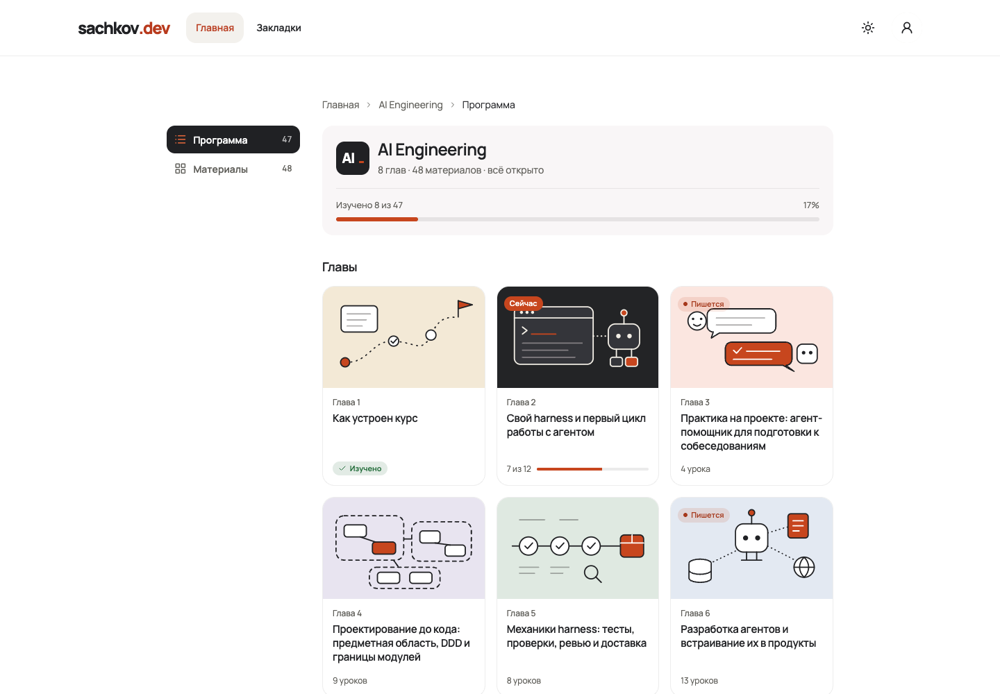
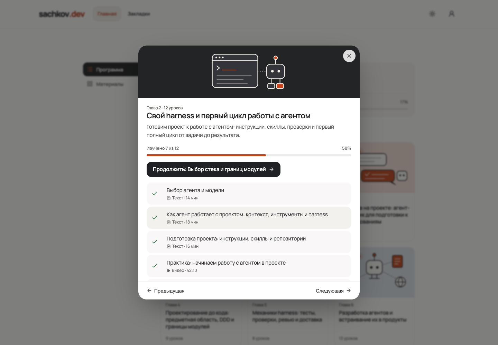
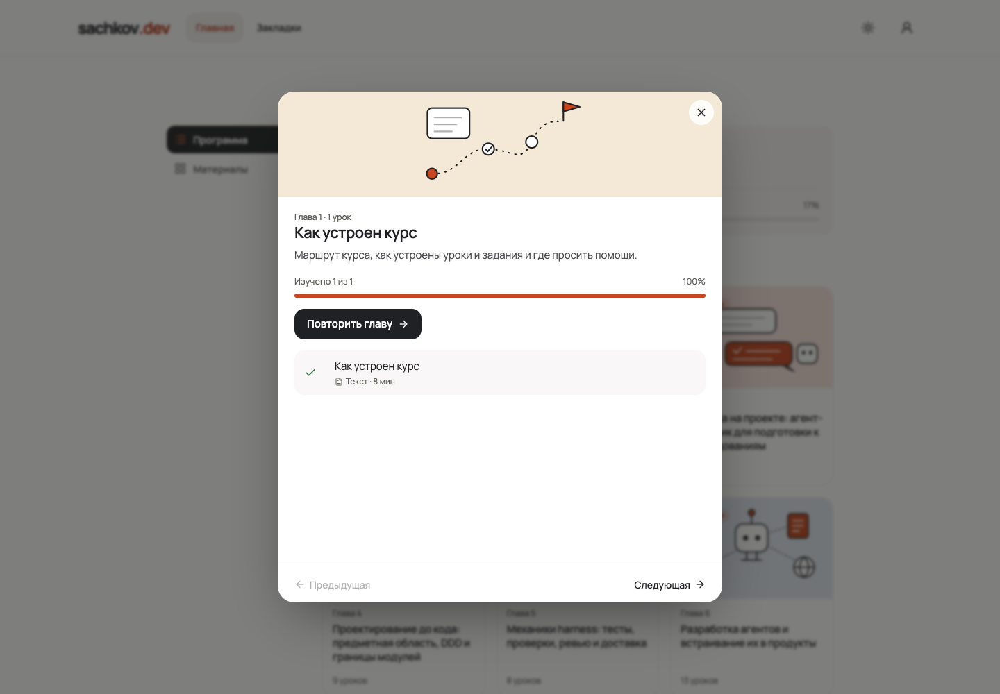
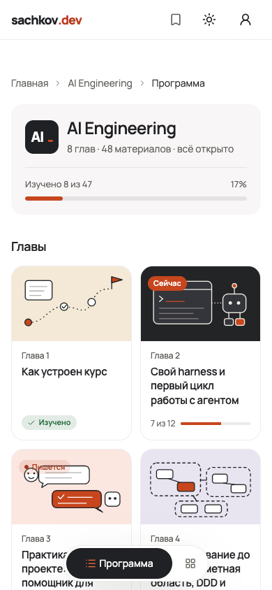
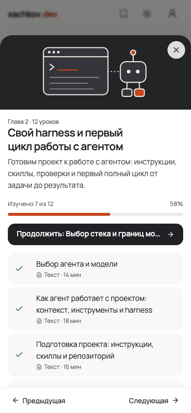

# Главы программы плитками, прототип

Задание владельца 2026-11-23: вместо раскрывающихся строк глав на странице программы показать главы
плитками с иллюстрациями и решить, как человек видит уроки главы. Прототип:
`apps/web/src/_pages/library-discovery/ui/chapter-tiles-prototype.stories.tsx`, группа историй
`Prototypes/Главы курса плитками`. Только тестовые данные курса AI Engineering, продовый код этот файл
не импортирует.

Сравнивались три варианта:

1. **A. Плитки и окно главы.** Нажатие на плитку открывает окно с иллюстрацией, описанием, прогрессом,
   кнопкой «Продолжить / Начать главу / Повторить главу», списком уроков и стрелками
   «Предыдущая / Следующая».
2. **B. Плитки и раскрытие на месте.** Уроки открываются панелью под рядом плиток.
3. **C. Текущая глава сверху, плитки ниже.** Крупный блок текущей главы, маленькие плитки переключают
   главу в этом блоке.

## Решение владельца

Выбран вариант A (2026-11-23), B и C удалены. Уточнения владельца:

- колонка разделов курса («Программа / Материалы») остаётся на странице; на телефоне её роль
  по-прежнему играет нижняя панель;
- окно главы одной высоты для любой главы, чтобы при листании стрелками оно не меняло размер: на
  компьютере `min(46rem, 100dvh - 4rem)`, на телефоне шторка снизу на весь экран, кроме полосы
  4.5rem сверху, через которую видна страница.

Плитка несёт иллюстрацию главы, номер, название, прогресс («7 из 12» с полоской, «Изучено» или число
уроков) и метки «Сейчас», «Пишется», «В планах»; иллюстрация главы «в планах» обесцвечена.

Проверено в headless Chromium на 1440, 900 и 390 по ширине: без горизонтальной прокрутки, окно и
шторка одного размера для глав с одним и с тринадцатью уроками.

