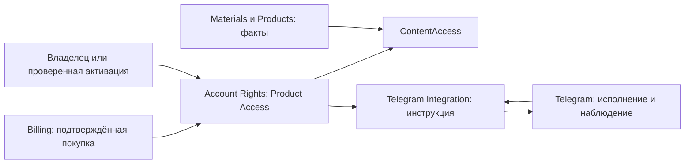

# Карта контекстов Platform

Целевая архитектура по [доменной карте](https://github.com/sachkov-inside/platform/issues/1644),
23.10.2026. Реализация ещё предстоит. [Словарь](../../GLOSSARY.md) определяет значения,
[модель доступа](access-model.md) определяет продуктовые правила. Эта карта определяет владельцев
фактов и взаимодействия. Она сохраняет один backend и отдельное приложение Telegram.

## Владельцы фактов

| Контекст и целевой Module | Единственный владелец | Что получает через interface |
| --- | --- | --- |
| Accounts | Account, проверенные способы входа, permissions, Billing Contact, Legal Acceptance | Проверенную identity провайдера; не выводит identity из адреса чека |
| Account Profiles (сейчас member-profiles) | Приватные имя, biography, avatar, история ограничения профиля | Account и разрешение автора увидеть только активное имя при просмотре сдачи |
| Materials | MaterialBody, publication, taxonomy, ссылки на медиа, связанные материалы, первый повод анонса | Принадлежность Product и решение доступа через порты, без знания цены и платёжных правил |
| Products (выделяется из materials) | Product, каталог, programme placements, главы, attachments, step sequences, Product Artifact и его placements, описание, архив и выбор обложки Product | Проверенные факты Material, актуальное число обладателей для подтверждения снятия материала |
| Assets, Videos и Content Covers | Соответствующий ресурс, загрузка, готовность, удаление и сохранность объектов | Разрешённое владельцем связывание и ContentAccess перед защищённой выдачей |
| Product Tasks | Task, неизменяемые Task Version и Submission, текущая самопроверка, Author Feedback | Product/Chapter и Material references, текущий допуск Account |
| Reading Activity | Ручное чтение, открытия, Product Learning Started, общий Product Mode | Текущую опубликованную программу; вычисляет прогресс и продолжение |
| Bookmarks | Личная связь Account и Material | Текущую видимость и доступ; сама связь права не создаёт |
| Account Rights | Один Product Access на Account и Product, история выдачи, отзыва и восстановления, ActivationRule и проверенное основание прежнего курса | Подтверждённую оплату, проверенное course evidence, явное действие владельца, факты каталога и связи через порты |
| Billing | Product Price, Promotion, PriceQuote, Payment Link, Purchase, PaymentAttempt, Payment, Refund, банковская сверка и исходящая выдача | Product, Account, точную Legal Acceptance; право меняет только через Account Rights |
| Product Sales (facet Billing) | Текущее Product Sales State и решение о приёме новых платежей | Архив Product; изменение плашки не создаёт Intake и не отправляет рассылку |
| Sales Funnel | Неизменяемые принятые события пути к покупке, Product Intake, членство и события Product Waitlist, исходящее подтверждение записи | Текущий Product Access, доступность продажи и Telegram binding через interfaces |
| Telegram Integration (сейчас telegram-membership) | Подтверждённая связь со стороны Platform, Product Community, производная команда доставки, outbox и свежая авторизация эффекта | Product Access и группу назначения; не создаёт прав по реальному составу чата |
| Telegram identity-linking/community | Доказательство Telegram identity, связь со стороны provider, наблюдения группы, ограничения, приглашения, принятые команды и внешние попытки | Последнюю точную инструкцию Platform и разрешение конкретного эффекта |
| Telegram bot-contacts/communications | BotContact, Contactability, Marketing Preference, шаблоны, Communication Sequence, Sequence Participation, Broadcast и аналитика сообщений | Разрешённые цели Platform, аудиторию конкретного ожидания, сервисные команды |
| Platform Communications | Авторизацию автора, проверку целей, outbox Tracking Hit и доступ к аудитории ожидания | Контент и Sales Funnel; Telegram владеет содержанием и исполнением цепочек |
| Notifications | Повод для Notification, получателя, настройки Account, независимые каналы и разрешение доставки | События Billing/Materials; Telegram исполняет отдельную идемпотентную команду |
| ContentAccess | Решение allow/deny/unavailable по Subject, Action и Resource, без собственных таблиц | Факты ресурсов, permissions и Product Access через consumer-owned ports |
| ContentLibrary | Текущую читательскую проекцию и поиск, без второй копии Product/Material или прав | Interfaces Products, Materials, ContentAccess и продажи; не пишет их таблицы |
| Web Product Reader State | Одно согласованное представление положения читателя за запрос, без durable state | Доступ, продажу, продолжение, onboarding и ожидание из backend; не принимает решение о выдаче права |
| Web telemetry | Наблюдения клиентского исполнения и полноты измерения | Технические события; telemetry coverage не является охватом продукта или правом |

Content Covers остаётся одной media capability. При выделении Products её общий жизненный цикл
выносится из смешанного Materials authoring в собственный interface, а не копируется для Product.
Products владеет выбором своей обложки, Content Covers владеет загрузкой и удалением ресурса.
Отдельный процесс, универсальная медиатека и новый пользовательский редактор не добавляются.

## Направление зависимостей

Products читает Materials через публичный interface. Если публикации Material нужна принадлежность
Product, Materials объявляет узкий порт этих фактов. Его adapter связывается выше обоих Modules.
Materials не импортирует Products, Billing или Account Rights ради сборки продажи или доступа.
Аналогично Account Rights объявляет нужные ему порты каталога и получателей, не импортируя их
реализаторов. Общие идентификаторы лежат ниже потребителей, без второго определения сущности.

ContentAccess описывает порты фактов и ничего не знает о реализации владельцев. Сборка adapters
происходит в composition entrypoints над владельцами. Защищённые reader/media/Task операции
обращаются к этому interface. ContentLibrary объединяет чтения, но не становится источником
права или владельцем Product. Продажа не собирается внутри Material reader.

Billing подтверждает банковский факт и записывает восстанавливаемую выдачу. Account Rights
применяет её идемпотентно. Telegram Integration выводит инструкцию из права, а Telegram сообщает
реальный результат. Обратное сообщение не создаёт право. Внешний вызов не входит в транзакцию
PostgreSQL. Команда и её durable outcome переживают потерю ответа.

Стрелки диаграммы обозначают передачу фактов, не разрешение циклических импортов.
[ADR 0029](../adr/0029-acyclic-module-dependencies.md) остаётся правилом для фактического графа,
включая type-only imports. Composition tests проверяют все API, MCP и worker entrypoints.

## Транзакция между владельцами

Сохраняется одна атомарная транзакция, когда операция действительно меняет несколько Modules.
Вызывающий передаёт непрозрачный transaction handle, владелец разворачивает его только в свой
ограниченный клиент. Никаких чужих delegates у вызывающего, generic repository или Unit of Work.
Одна операция выполняет собственные проверки в той же транзакции; prepare/apply пары удаляются.
Это уточнение уже принятого архитектурного поручения, записанное в
[ADR 0039](../adr/0039-opaque-transaction-handoff.md).

Там, где нужен внешний банк или Telegram, атомарность заменяется существующими outbox/inbox,
неизменным operation ID, повторным чтением результата и точной проверкой актуальности. Журналы
разных приложений сохраняются. Общая база между ними не вводится.

## Переход из текущего кода

- Product и его композиция переезжают из materials в Products. Идентичности, programme occurrences,
  каталожные связи и история сохраняются. `series` переименовывается через совместимое расширение,
  перенос потребителей и удаление старой формы. Применённые миграции не редактируются.
- Совместимость не сливает каталог, programme placements и attachments. `programmeExplicit`
  удаляется после переноса автоматической старой программы в явные placements.
- Старый PracticeDefinition выводится только после переноса оставшихся требований и потребителей
  в Product Tasks. Учебный путь и незакрытые решения другой карты не подменяются этим переносом.
- Путь покупки становится Product purchase; тарифы, подписки, Tribute, invitations и legacy bridge
  удаляются, а не остаются выключенной функцией. Исторические финансовые и юридические факты,
  Accounts, binding, audit и личные учебные факты сохраняются.
- Product Reader State заменяет повтор дерева решения в Home и слотах страницы. Состояния:
  обучение, продажа, ожидание, уточнение, недоступность. Ожидание выбирается по данным Product,
  не по slug. Личная часть не кешируется, неизвестный ответ не превращается в отказ или продажу.
- Переименование Account Profile сохраняет непрозрачные ID, историю модерации и доступ автора
  только к активному display name при работе со сдачами. Публичный профиль не появляется.
- Перенос covers сохраняет текущие проверки upload/reference/delete и их историю. Новый interface
  прячет общий жизненный цикл, а не добавляет параллельное хранилище.

Физические миграции выполняются только будущими implementation tickets после инвентаризации
технических данных и доказательства восстановления. Заявление владельца об отсутствии получателей
продукта не означает отсутствия Accounts, банковских записей или принятых документов.
