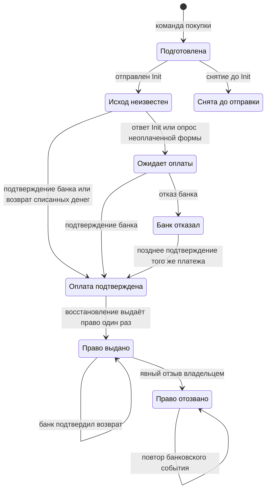

# Модель оплаты и доступа, оценка audit9 (#2252)

Исполняемая модель проверила 20 состояний и 300 переходов одной покупки без контрпримера.
Обход замкнулся на глубине 7, раньше ограничений 12 шагов и 2 000 состояний. Это проверка
небольшой модели существующего договора, а не доказательство отсутствия ошибок в работающем
BillingPayments. Реальные SQL, адаптеры, версии и время проверяются отдельно интеграционными тестами.

Покупка и право в коде модели хранятся раздельно. Схема показывает путь человека; она не
объединяет их в новый продуктовый статус. Возврат записывает финансовый факт. Сам по себе он не
отзывает право, а подтверждённый полный возврат может доказать списание, если `CONFIRMED` не дошёл.

## Контракт и границы модели

Источники: [действующая модель доступа](../product/access-model.md),
[аудит](2026-11-16-architecture-audit.md), решения #2244, свойства PR #2249 и пилот #2251/PR #2256.
Модель не вводит новое поведение, автоматический отзыв, подписку или срок ProductAccess.

Объекты ограничены одним Account, Product, Purchase и одной повторяемой командой. События делят
подготовку покупки, отправку Init, факт банка, получение ответа, выдачу права и ручной отзыв.
Потерянный ответ Init, недоступный банк и недоступный работник допускают шаг без изменения.
Повтор команды и доставка одного факта снова не создают новую покупку, Init или выдачу.
Старое уведомление неоплаченной формы не может отменить уже принятое подтверждение.

Допускаются только подписанные и связанные с этой покупкой банковские факты. Подпись, сумма,
TerminalKey, PaymentId и OrderId находятся за границей модели и имеют реальные проверки.
Каждый переход считается атомарным. Модель не доказывает SQL-транзакции, блокировки, несколько
одновременных покупок, несколько продуктов, транспорт или восстановление процесса после SIGKILL.
Срок потерянного адреса формы, версии контента и бессрочные права оставлены настоящим адаптерам.

Проверяются инварианты:

- Одна команда сохраняет не больше одной покупки и одного Init.
- Одна покупка выдаёт право не больше одного раза.
- Без доказанного списания право не выдаётся. Неизвестность сама права не даёт.
- Снятие до Init сохраняет ноль отправок и выдач.
- Только явный отзыв меняет право на отозванное, повтор банковского события не восстанавливает его.

Условие прогресса проверено для восьми состояний, где деньги списаны, а право ещё не выдано:
если банк снова отвечает и выдача снова работает, последовательность `poll, fulfill` выдаёт право.
Предполагается, что сверка и выдача действительно получат очередь выполнения. При вечном сбое банка
или работника модель не обещает завершения. Планировщик, интервалы повторов и их реальное время
в это утверждение не входят.

## Воспроизведение и короткие трассы

`pnpm pilot:payment-model` сохраняет результат в `.reports/2252/model.json` и завершает команду
с ошибкой при контрпримере или незавершённом обходе. Семь дешёвых tooling tests выполняют обход,
проверяют конкретные пути и намеренно ошибочные модели. Эти проверки занимают около 40 мс локально,
без банка, Docker и новой зависимости.

| Намеренная ошибка модели | Найденная трасса | Что нарушено |
| --- | --- | --- |
| Выдать право из неопределённости | `command, dispatch, fulfill` | Init ушёл, списание не доказано, права быть не должно |
| Повторно выдать уже выданное | `command, dispatch, bank_captures, callback, fulfill, fulfill` | Две выдачи одной покупки |
| Не выдавать после подтверждения | `command, dispatch, bank_captures, poll, fulfill` | Прогресс отсутствует даже при успешной сверке и выдаче |
| Автоматически отозвать после возврата | `command, dispatch, bank_captures, callback, fulfill, bank_refunds` | Отзыв произошёл без команды владельца |

Обычный путь с возвратом до доставки подтверждения:
`command, dispatch, bank_captures, bank_refunds, callback, fulfill`.
Право выдано один раз. После `owner_revoke, callback, fulfill` оно остаётся отозванным.

## Связь с настоящими проверками

| Переход или правило модели | Реальная проверка backend | Что модель не заменяет |
| --- | --- | --- |
| Повтор команды, callback и выдачи | `billing-sequences.test.ts`, четыре seed и отдельные БД; `billing-payments.test.ts` | Уникальность, журнал и транзакции PostgreSQL |
| Потерянный Init и подтверждение через poll | В `billing-sequences.test.ts` seed42 начинает с банка без callback; `billing-lost-form-address.test.ts` | Точный порог времени до и на границе, ответ настоящего адаптера |
| Неизвестность без права | `PAY_CHECKING before any refusal or confirmation` из PR #2256 | Настоящий BillingPayments, история покупки и чтение ProductAccess |
| Снятие до Init | `billing-dispatch-retirement.test.ts`, `billing-sequences.test.ts` | Причины снятия, допуск продажи и сохранённое событие |
| Возврат не отзывает право | `billing-one-time-purchase.test.ts`; `product-purchase.test.ts`, `refund_first` | Финансовый журнал, подтверждение списания возвратом и явный отзыв |
| Права открывают только свои ресурсы | `lifetime-product-content-access.test.ts` | Material, Asset, Video, Task, публикация, версия, отказ БД, scalar/batch и itemId |

Контрпример модели показывает ошибку её переходов, а не автоматически найденный дефект backend.
Реальное проявление требует отдельного воспроизведения через capability и PostgreSQL.

## Оценка audit9

**Рекомендация: сохранить отсрочку структурной перестройки BillingPayments.** Новые проверки и
пилоты дали конкретные пробелы тестов, но не воспроизвели дефект производственного поведения:

- Ревью свойств обнаружило общее изменяемое состояние тестовой БД и отсутствие гарантированного
  poll-first сценария. Исправлены изоляция и корпус, производственный модуль не менялся.
- Пилот мутаций обнаружил, что неопределённый статус приходил слишком поздно. Короткий пример
  закрыл этот пробел. Вариант с возвратом остаётся пробелом выбранных последовательностей,
  а не доказательством провала всех существующих проверок.
- Реальные интерфейсы позволяют проверить сохранение, повтор команды, выдачу и политику ресурсов
  без подмены собственных модулей. Для этих проверок не понадобился новый слой хранения или
  разделение backend на приложения.
- В модели нет контрпримера, но её атомарность и ограниченный набор объектов не доказывают
  отсутствие ошибок порядка транзакций в настоящей системе.

Сохраняется реальная связь между подтверждением оплаты, доказательством списания через возврат,
постоянной отметкой выдачи и ручным отзывом. Отделять их лишь из-за размера файла пока не обосновано.
Следующий адресный шаг, если расширять проверки, состоит в генерации возвратов, частичных возвратов,
опоздавшего Cancel и пересечений двух покупок. Основанием для структурной задачи станут
воспроизведённая ошибка порядка, необходимость подменять собственный модуль или повторяющаяся
связка изменений нескольких участков с измеримой ценой сопровождения. Таких новых свидетельств
этот опыт не дал. Текущие решения audit8/11 и архитектура Telegram сохранены.
