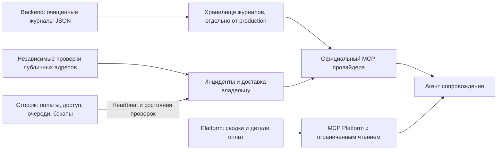

# Мониторинг Platform: лёгкий запуск, платежи и доступ агентов

Дата исследования: 2026-10-13. Задача: [Platform #1289](https://github.com/sachkov-inside/platform/issues/1289).

Статус: исследование вариантов перед выбором системы. Отчёт не утверждает новый эксплуатационный контракт.
Аккаунты, платные услуги, установки и изменения production в исследовательский объём не входят.
Цены указаны в USD по публичным источникам; итоговый счёт зависит от объёма и условий поставщика.

## Что стоит выбрать

Для начала Platform нужен независимый наблюдатель и несколько проверок критических процессов.
Полный стек журналов, метрик и трассировок можно добавлять после измерения конкретного пробела.
Проверки платежей должны сохранять нынешние правила приложения и SQL-проверки watchdog.
Watchdog — существующий процесс, который проверяет состояние сервисов и бизнес-данных.

Есть два разумных направления:

- **Свой независимый монитор.** Uptime Kuma проверяет доступность, Healthchecks принимает сигналы завершения фоновых задач.
  Это направление сохраняет предпочтение собственной инфраструктуры, но требует обслуживания и отдельного доступа агентов.
- **Готовый сервис Better Stack.** Один поставщик соединяет внешние проверки, фоновые задачи, журналы и инциденты.
  Официальный MCP уже даёт агентам широкий доступ. Передача серверных данных поставщику требует решения владельца.

Рекомендация исследователя: сначала выбрать между этими направлениями, сохранив небольшое число проверок.
Если собственная инфраструктура остаётся приоритетом, начать с Uptime Kuma на независимом сервере.
Healthchecks добавлять, если нужны расписания, длительность задач и удобный API для агентов.
Если важнее готовый общий MCP без обслуживания хранилищ, проверить Better Stack ограниченным пилотом.

Grafana подходит, когда нужны история метрик, свои запросы и панели для разбора причин.
Sentry полезен прежде всего для серверных исключений и связи ошибки с выпуском приложения.
Оба варианта рассмотрены ниже; наличие MCP само по себе не определяет подходящую систему.

## Что мониторинг должен доказывать

Доступность HTTP, успешная фоновая задача и выданный доступ после оплаты — разные результаты.
Ответ HTTP 200 показывает только результат конкретного запроса с конкретными проверками тела.
Он не доказывает, что банк подтвердил платёж или участник получил правильный доступ.

Для платежей нужны отдельные сигналы приложения: подтверждённый платёж без доступа, просроченная обработка уведомления,
застрявшая сверка состояния банка и незавершённая выдача доступа.
Возраст проблемной записи и её состояние полезнее отсутствия оплат за последние 30 минут.
При небольшом числе покупок отсутствие новых оплат может быть нормальным.
Это предложенная модель проверок, а не найденные возможности банковского мониторинга у поставщиков.

Периодический сигнал, heartbeat, означает: задача завершилась и сообщила об этом наблюдателю.
Если задача пропускает срок, наблюдатель сообщает об остановке.
Сигнал нужно отправлять после проверки результата задачи; сигнал при старте не доказывает её успех.
Для безопасной проверки полного платёжного пути нужен отдельный тестовый сценарий с проверкой итогового доступа.
Регулярные реальные списания этим исследованием не предлагаются.

Наблюдатель должен переживать остановку основного сервера.
Если Uptime Kuma, отправитель уведомлений и приложение находятся на одном VPS, общий отказ отключит их одновременно.
Поэтому собственный монитор нужен на другом сервере; желательно использовать другого поставщика или независимую площадку.
Для этого не требуется переносить основную базу или собирать все журналы в новом хранилище.

## Сравнение вариантов

| Вариант | Что закрывает сначала | Доступ агентов | Цена и нагрузка | Основной предел |
|---|---|---|---|---|
| [Better Stack](https://betterstack.com/docs/getting-started/integrations/mcp/) | Внешние проверки, heartbeat, инциденты; затем журналы | Официальный удалённый MCP, OAuth, API | Free; responder от $34/месяц. Локальное хранилище не требуется | Передача данных поставщику; уточнение квот и Telegram |
| [Grafana Cloud](https://grafana.com/docs/grafana-cloud/ai-tools/mcp-servers/cloud-mcp/) | Внешние проверки, метрики, журналы, правила оповещений | Официальные hosted MCP и локальный OSS MCP | Free; Pro $19/месяц плюс потребление | Больше настроек и отдельных счётчиков оплаты |
| [Sentry](https://mcp.sentry.dev/) | Серверные исключения, выпуски, фоновые задачи, uptime | Официальный MCP для диагностики и ограниченный API | Free; Team $29/месяц | Не заменяет проверки платёжных данных |
| [Uptime Kuma](https://github.com/louislam/uptime-kuma) | HTTP/JSON, TCP, DNS, push, Telegram/email | Официальный MCP не подтверждён; есть сторонние обёртки | MIT, без платы за ПО; отдельный сервер | Доступ агентов слабее готовых сервисов |
| [Healthchecks](https://healthchecks.io/docs/api/) | Пропуски, ошибки и длительность фоновых задач | Официальный API, проектный ключ только для чтения | Свой BSD-3-Clause; hosted Free до 20 задач | Не является внешним HTTP-монитором или хранилищем журналов |
| [VictoriaMetrics + Grafana](https://docs.victoriametrics.com/victoriametrics/single-server-victoriametrics/) | История метрик и собственные правила | Официальный Grafana MCP через источник метрик | Свободное ПО; ресурсы и обслуживание своих процессов | Дополнительное хранилище, сбор и контроль самой системы |

«Локальное хранилище не требуется» не означает нулевую нагрузку.
Внешние проверки создают запросы, а отправка журналов требует процессорного времени, памяти и сети.
Фактическая нагрузка выбранного варианта на Platform пока не измерена.

## Better Stack: готовый общий контур

На [странице цен](https://betterstack.com/pricing) Free включает 10 monitors & heartbeats, одну status page и email/Slack.
Там же указаны 3 GB журналов ежемесячно с хранением три дня и 30 GB метрик.
Responder стоит $34/месяц или $29/месяц при годовой оплате.
Дополнительные 50 HTTP-мониторов стоят $25 или $21 соответственно; дополнительные 10 heartbeats — $20 или $17.
Платный сбор журналов указан отдельно: $0.10/GB; хранение — $0.05/GB в месяц.
Playwright-проверки стоят $1 за 100 минут; они не нужны для первого серверного пилота.

Квота Free неоднозначна: [страница Uptime](https://betterstack.com/uptime) обещает 10 monitors и 10 heartbeats с интервалом три минуты.
Общая страница цен формулирует лимит совместно.
До подтверждения в кабинете нельзя считать 20 проверок гарантированным бесплатным объёмом.
На сайте Free назван вариантом для personal projects; применимость к Platform следует уточнить перед выбором.

Официальный [MCP](https://betterstack.com/docs/getting-started/integrations/mcp/) работает по HTTP с OAuth или API token.
Агент видит мониторы, heartbeats, инциденты, историю и конфигурацию оповещений.
Через SQL агент запрашивает журналы, метрики, ошибки и трассировки.
MCP также создаёт и изменяет ресурсы; по умолчанию доступны все инструменты.
`X-MCP-Tools-Only` ограничивает набор инструментов, поэтому подходит для первоначального доступа только к чтению.
Но фильтр инструментов не доказывает, что сам credential не может изменять данные через другой интерфейс.

[Incidents API](https://betterstack.com/docs/uptime/api/getting-started-with-uptime-api/) различает глобальный token и token отдельной команды.
На этой странице отдельные права только для чтения не описаны; их наличие остаётся непроверенным.
Поэтому для пилота нужны отдельный credential, ограниченный набор инструментов и проверка фактических запретов.
Агентам не нужен глобальный административный token.

В [каталоге интеграций](https://betterstack.com/docs/uptime/slack/) найдены email и исходящие webhooks.
Встроенная Telegram-интеграция не подтверждена.
Отправку через webhook и собственного Telegram-бота следует считать отдельной интеграцией, которую нужно проверить.
Такой отправитель должен работать независимо от основного VPS.
Иначе общий отказ сервера оставит внешний монитор без выбранного канала оповещений.

## Grafana: больше гибкости и официальные MCP

[Grafana Cloud Free](https://grafana.com/pricing/) включает 10 000 активных рядов метрик и 50 GB журналов ежемесячно.
Метрики и журналы хранятся 14 дней.
Квота внешних проверок составляет 100 000 API executions и 10 000 browser executions в месяц.
Execution учитывает проверку, место запуска и минуты исполнения; несколько площадок расходуют квоту быстрее.
Pro стоит $19/месяц плюс потребление сверх квот; метрики хранятся 13 месяцев, журналы — 30 дней.
Дополнительные API executions начинаются с $5 за 10 000; дополнительные 1 000 рядов метрик — с $6.50.

Для первого этапа подходят внешние API-проверки и небольшой набор метрик приложения.
Отдельный инфраструктурный collector нужен только для внутренних сведений, например памяти или диска.
[Grafana Alerting](https://grafana.com/docs/grafana/latest/alerting/fundamentals/notifications/contact-points/) поддерживает email, Telegram и webhooks.
Поэтому собственный посредник для Telegram не обязателен.
Полный набор трассировок и постоянный сбор всех журналов следует оценивать отдельно.

Есть два официальных пути MCP.
[Grafana Cloud MCP](https://grafana.com/docs/grafana-cloud/ai-tools/mcp-servers/cloud-mcp/) работает удалённо с OAuth 2.1 и правами пользователя.
[OAuth-настройки](https://grafana.com/docs/grafana-cloud/ai-tools/mcp-servers/register-oauth-client/) различают Read only, Read and query и Full access.
Read only исключает raw SQL; Read and query допускает SQL, который может изменять данные.
Для агентов диагностики первый режим предпочтителен.

Удалённый MCP входит в Assistant; подключённый пользователь считается активным даже без расхода токенов моделей Grafana.
[Правила оплаты](https://grafana.com/docs/grafana-cloud/platform/pricing-and-usage/assistant/) считают пользователя один раз за месяц во всех stacks организации.
Free и Pro включают три активных AI-пользователя; дополнительный пользователь стоит от $20/месяц.
Запросы данных через MCP сами по себе не расходуют токены Assistant.
Число процессов агентов нельзя автоматически считать числом оплачиваемых пользователей: важно, кем авторизованы подключения.

[Локальный OSS MCP](https://github.com/grafana/mcp-grafana) работает с Cloud и своей Grafana через service account.
`--disable-write` убирает операции изменения и raw SQL; PromQL/LogQL-запросы остаются.
Это позволяет читать метрики и журналы без hosted Assistant.
Нужны отдельный service account с минимальными правами и закреплённая версия MCP.
Необходимо проверить, какие данные выбранные источники реально дают агенту; Grafana не создаёт отсутствующие платёжные сигналы.

## Sentry: диагностика серверных ошибок

[Публичная цена Sentry](https://sentry.io/pricing/) подтверждена по HTML официальной страницы.
Free ограничен одним пользователем: 5 000 ошибок, 5 GB журналов, один uptime monitor и один cron monitor.
MCP доступен на Free.
Team стоит $29/месяц или $26/месяц при годовой оплате; включает 50 000 ошибок и неограниченное число пользователей.
Business стоит $89 или $80 соответственно.
Данные сверх квот оплачиваются отдельно; для этого нужен pay-as-you-go budget.

Sentry умеет проверять не только статус ответа.
[Официальное обновление uptime](https://sentry.io/changelog/uptime-monitors-expanded-alert-configuration/) описывает проверки заголовков и JSONPath-полей тела.
Один такой монитор может доказать доступность выбранного endpoint, но не корректность всех обработчиков платежей.
Серверный SDK добавит исключения и связь с выпуском; необходимость SDK стоит проверить на реальных диагностических пробелах.
Email подтверждён на Free; встроенный Telegram в рассмотренных официальных источниках не найден.

[Официальный удалённый MCP](https://mcp.sentry.dev/) использует OAuth; подключение можно ограничить организацией и проектом.
Поставщик прямо [описывает назначение MCP](https://github.com/getsentry/toolkit) как диагностику для coding agents.
Это не полный интерфейс ко всем функциям Sentry.
[Skill `inspect`](https://github.com/getsentry/toolkit/blob/main/packages/mcp-core/README.md) читает ошибки, проекты и трассировки.
Для локального MCP минимальные upstream scopes: `org:read`, `project:read`, `team:read`, `event:read`.
`triage`, `project-management` и Seer для первоначальной диагностики не требуются.

Стороннюю браузерную аналитику и Session Replay этот выбор не добавляет.
Граница [#707](https://github.com/sachkov-inside/platform/issues/707) сохраняется; здесь рассматривается только серверная диагностика.
Совместимый с Sentry SDK приём ошибок у другого продукта не гарантирует совместимость с официальным Sentry MCP.

## Свой монитор: Uptime Kuma и Healthchecks

[Uptime Kuma](https://github.com/louislam/uptime-kuma) поддерживает HTTP/JSON-проверки, TCP, DNS, push и уведомления через Telegram/email.
Push позволяет отправлять результат существующей проверки, поэтому отдельный Healthchecks не обязателен для простого сигнала «задача жива».
Kuma не является общим хранилищем журналов и исключений.
Официального MCP в рассмотренных источниках не найдено.
Сторонние MCP существуют, но требуют отдельного анализа совместимости и доступа.

Например, [сторонний `mcp-uptime-kuma`](https://github.com/DavidFuchs/mcp-uptime-kuma) подключается через Socket.IO с credentials Kuma.
Его документация предупреждает: HTTP endpoint без дополнительных настроек даёт доступ к чтению и изменению.
Это источник самого адаптера, а не обещание разработчиков Kuma.
Такую обёртку нельзя считать готовым официальным интерфейсом с ограниченными правами.
Первый этап может дать агенту состояние через существующий проектный MCP или ограниченный экспорт проверок.
Это предложение отдельной реализации, а не уже готовая возможность Platform.

[Healthchecks](https://github.com/healthchecks/healthchecks) специализируется на завершении фоновых задач и пропущенных сроках.
Он полезен для сверки платежей, резервного копирования и выполнения самого watchdog.
ПО доступно для своего размещения; требуются web-процесс, база и отправитель оповещений.
[Своя Telegram-интеграция](https://healthchecks.io/docs/self_hosted_configuration/) требует bot token и публичного HTTPS для настройки webhook.
Email требует настроенного отправителя.

[Management API](https://healthchecks.io/docs/api/) даёт проектный ключ только для чтения.
Он читает проверки, состояния и историю смены состояния, но не подробные ping logs или их тела.
Это существенный предел для полного разбора инцидента агентом.
API можно использовать непосредственно; официальный MCP не подтверждён.
[Hosted Free](https://healthchecks.io/pricing/) включает 20 задач и 100 записей на задачу.
Business стоит $20/месяц или $192/год: 100 задач и 1 000 записей на задачу.

## Метрики и фактические ресурсы

VictoriaMetrics имеет смысл после появления конкретных вопросов к истории метрик.
Одноузловая версия [сама собирает Prometheus-метрики](https://docs.victoriametrics.com/victoriametrics/single-server-victoriametrics/#how-to-scrape-prometheus-exporters-such-as-node-exporter).
Поэтому отдельный vmagent не всегда нужен.
Grafana строит панели и оценивает правила; официальный Grafana MCP читает этот источник.
Для журналов потребуется другое хранилище, поэтому первая установка метрик не решает весь разбор ошибок.

Числа ресурсов нужно отличать от обещаний низкой нагрузки:

- [Grafana](https://grafana.com/docs/grafana/latest/setup-grafana/installation/) указывает минимум 512 MB памяти и одно ядро для собственного процесса.
  Этот минимум не включает хранилища метрик, журналов и трассировок.
- [VictoriaMetrics](https://docs.victoriametrics.com/victoriametrics/single-server-victoriametrics/#capacity-planning) требует подбирать ресурсы по числу рядов, запросам и скорости поступления.
  Документация рекомендует измерить свой поток и оставить запас CPU, памяти и диска.
- В просмотренных официальных инструкциях Kuma и Healthchecks общий гарантированный минимум RAM/CPU не найден.
  Размер отдельного VPS нужно доказать пилотом; число «512 MB достаточно» сейчас было бы предположением.
- [GlitchTip](https://glitchtip.com/documentation/install/) публикует минимум 256 MB для all-in-one и рекомендацию 512 MB.
  Но ему нужен PostgreSQL; это отдельный кандидат для собственных серверных ошибок, а не обещание общей нагрузки всего стека.

GlitchTip можно вернуться изучать, если появится потребность в группировке серверных исключений без Sentry SaaS.
Официальный полный MCP для него в этом исследовании не подтверждён.
Кластерный стек сейчас не обоснован количеством проверок или измеренным потоком данных Platform.

## Где окажутся данные

Расположение данных — решение владельца вместе с допустимым составом телеметрии.
Существующее предпочтение собственной инфраструктуры нельзя считать согласием на серверный SaaS.
EU-регион также нельзя считать доказательством хранения всех данных только в EU или юридической достаточности.

Better Stack [предлагает](https://betterstack.com/community/blog/changelog-9-advanced-data-options-for-everyone/) US East, US West, Germany и Singapore для Telemetry sources.
Источник описывает выбор на Pay as you go; условия Free следует уточнить.
Grafana Cloud [позволяет выбрать регион stack](https://grafana.com/docs/grafana-cloud/learn-and-build/developer-resources/api-reference/cloud-api/).
Наличие региона не устанавливает местоположение всех вспомогательных данных или обработки моделей.

[Sentry EU FAQ](https://www.sentry.help/en/articles/13964378-sentry-s-eu-region-faq) различает события в выбранном регионе и часть метаданных в US.
Регион выбирают при создании организации; смена региона существующей организации не поддерживается.
Владелец должен отдельно выбрать разрешённые серверные поля, срок хранения и доступ поставщика моделей к диагностике.
Платёжные реквизиты, tokens, полные банковские уведомления, email и Telegram ID не нужны для агрегированных сигналов.
Допустимость регистрации и оплаты поставщику из России в этом исследовании не подтверждена и не опровергнута.

## Что уже работает в Platform

Срез репозитория: `a93c88502a06ea677acf3fa02498a2d00ef8ce28`, 13.10.2026.
Production читался по SSH без изменения конфигурации, запуска сторожа, платежей или отправки сообщений.
Срез сервера: 05:37–05:42 UTC; установлен Platform `v35`, исходный commit `635bf690dfb11bb8a5d55910dd81fd6502a67ce9`.
Это состояние на момент чтения, а не гарантия текущей доступности.

| Наблюдение | Проверенное значение | Следствие для выбора |
|---|---|---|
| Сервер | 2 CPU; 3910 MiB памяти; доступно 1375–1403 MiB; swap отсутствует | Сборщик допустим только после проверки бюджета; хранение лучше вынести с production |
| Корневой диск | 48 GiB; занято 77%; доступно около 12 GiB по `df -h` | Полные журналы и новый стек с базой требуют отдельного ограничения объёма |
| Сторож | Timer активен; два последних запуска завершились успешно примерно за 2 секунды | Существующие проверки можно сохранить |
| Расход сторожа | 0,763 и 0,845 CPU-с; пик памяти 10,8 и 11,0 MiB | Сторож небольшой; недельный расход и работа под нагрузкой не измерены |
| Контейнеры | Все контейнеры с healthcheck имели статус `healthy` | Это не доказывает успешную оплату или доставку доступа |
| Доставка сигналов | Файл `watchdog.env` отсутствует; repository secrets `MONITOR_*` отсутствуют | Получатель пока не получает сигналы через предусмотренные каналы |
| Журналы Platform | Текущие файлы девяти контейнеров суммарно 579 376 байт; ротация `20m × 5` на контейнер | Это размер текущих файлов, а не месячный объём поступления |

Команды чтения: `free -m`, `df -h /`, `docker ps`, `docker stats --no-stream`,
`systemctl show inside-watchdog.{service,timer}` и выборочное чтение deployment state.
Конфигурация доставки проверялась только на наличие файла и непустых ключей; значения секретов не выводились.

[Существующий runbook](../runbooks/production-monitoring.md) описывает минутные проверки процессов, ресурсов, бэкапов, оплат, доступа и Telegram.
Сторож читает очередь выдачи доступа, исходящие уведомления и завершение задачи сверки платежей.
Публичные проверки и суточный проход доступа работают отдельно в GitHub Actions.

У внешнего workflow задан интервал 10 минут, но последние плановые запуски имели многочасовые промежутки.
12 октября запуски начались в 09:26 и 19:16 UTC; следующий начался 13 октября в 01:27 UTC.
Источники: [запуск 09:26](https://github.com/sachkov-inside/platform/actions/runs/38229931385),
[запуск 19:16](https://github.com/sachkov-inside/platform/actions/runs/38296510467),
[запуск 01:27](https://github.com/sachkov-inside/platform/actions/runs/38332205680).
Причина промежутков не исследована. GitHub [допускает задержки и пропуск плановых запусков](https://docs.github.com/en/actions/reference/workflows-and-actions/events-that-trigger-workflows#schedule).
Поэтому интервал в YAML нельзя считать гарантированным временем обнаружения отказа.

В коде main уже есть [промежуточное хранение Web telemetry](../runbooks/web-telemetry.md) и инструмент `web_telemetry_summary`.
[#707](https://github.com/sachkov-inside/platform/issues/707) ещё открыта; её статус не подменяет факт наличия кода.
Браузерные показатели остаются self-hosted. Исследование не предлагает отправлять их стороннему провайдеру.
[Решение владельца от 13 октября](https://github.com/sachkov-inside/platform/issues/1289#issuecomment-6138965757) откладывает доставку сигналов до выбора стека.

## Минимальная схема для оплат и оповещений

Пример отказа: банк подтвердил оплату, но очередь не выдала доступ покупателю.
Сайт при этом может отвечать HTTP 200. Мониторинг должен обнаруживать задержку выдачи доступа независимо от доступности сайта.

Предложение сохраняет существующие SQL-проверки и добавляет независимый приём сигналов о работе сторожа.
Такой периодический сигнал называется heartbeat: получатель замечает, если следующий сигнал не пришёл вовремя.
Проверки публичных адресов работают за пределами production. Сборщик журналов нужен только для поиска причин и сохранения истории.

Это целевая схема, а не описание подключённых инструментов.
Для self-hosted схемы чтение внешних проверок потребует адаптера к API, если официального MCP нет.

| Ситуация | Предлагаемый сигнал |
|---|---|
| Production недоступен | Независимая проверка публичных адресов каждые 60 секунд; подтверждение повторной пробой |
| Сторож перестал выполнять цикл | Пропущен heartbeat; первоначальное окно 3 минуты, затем проверка ложных тревог |
| Банк подтвердил оплату, доступ задержался | Существующий порог очереди выдачи доступа: 5 минут |
| Сверка оплаты перестала завершаться | Существующая проверка последнего завершения `billing.payment-recovery` |
| Зависли письма или действия Telegram | Существующие проверки возраста очереди и ошибок доставки |
| Мониторинг не прочитал базу или журнал | Отдельное состояние «нет данных»; прежняя тревога сохраняется |
| Telegram relay недоступен | Независимая доставка через согласованный запасной канал |

Heartbeat показывает завершение цикла проверки, а не успешность всех бизнес-операций.
Каждый источник дополнительно хранит время последнего успешного чтения.
При отсутствии данных состояние не становится зелёным.
Согласованное окно выпуска подавляет ожидаемые отказы, но имеет срок окончания.

Сигнал содержит сервис, нарушение, возраст задержки, версию выпуска и ссылку на разбор.
Повторные события объединяются в один инцидент; рост задержки и восстановление обновляют его.
Почта и Telegram для инцидентов отделяются от транзакционных писем и бота продаж.

Отсутствие новых оплат при малом трафике не означает отказ.
Обычный отказ карты тоже не равен сбою платформы.
[Виды платежей в коде](../../apps/backend/src/modules/billing/features/read-payments/read-payments.ts) связывают подтверждение оплаты с готовностью доступа.
У этого чтения есть предел: готовность проекции не доказывает доступность материала для покупателя.
Существующий проход доступа проверяет последнюю часть отдельно.
Автоматические реальные покупки, возвраты и действия в боевых группах в исследовании не выполнялись.

## Как агент будет разбирать инцидент

Агент сопровождения сначала читает активные инциденты и возраст данных.
Затем он сопоставляет журналы по сервису, времени, `requestId` и версии выпуска.
Для оплаты он читает разрешённые детали в Platform и различает ожидание банка, выдачу доступа и доставку уведомления.
Ответ агента содержит проверенные факты, ссылки на записи и отдельно обозначенную гипотезу причины.

Официальный MCP даёт инструменты чтения провайдера, но не объясняет предметную область Platform автоматически.
В [текущем MCP Platform](../../apps/backend/mcp/tool-surface.json) есть `billing_payments_list`, `billing_payments_read` и `web_telemetry_summary`.
Единой сводки здоровья backend, всех очередей и инцидентов сейчас в этом наборе нет.
Она остаётся предложением для следующей спецификации.

Чтение оплат сегодня требует `billing:manage`, а Web telemetry требует `platform:admin`.
Эти права шире диагностического чтения. Пометка `readOnlyHint` сама по себе права не ограничивает.
Предлагаемый доступ для агентов сопровождения должен разрешать только нужные операции на стороне сервера.
Учебный MCP `/mcp/learning` сохраняет свою область и не получает доступ к production-мониторингу.
Для фонового агента отдельно проверяются обновление авторизации, срок токена и отказ при потере доступа.

В метрики попадают счётчики и возраст задержек, без идентификаторов аккаунтов и платежей.
`requestId` остаётся полем поиска в журнале, а не меткой метрики: иначе число рядов быстро растёт.
Персональные детали оплаты остаются в Platform и читаются только при разрешённом разборе конкретного случая.
Существующий [журнал backend](../runbooks/backend-logs.md) уже исключает тела запросов и редактирует чувствительные значения.
Перед экспортом всё равно нужна проверка фактической выборки журналов.

## Предложенный пилот и критерий выбора

Пилот предложен, но не выполнен. Предполагаемая длительность: 7 дней после выбора владельцем.
Одинаковый минимальный набор для сравнения: один владелец, 6 публичных проверок раз в минуту и один heartbeat сторожа.
Для поиска причин рассматриваются до 2 GB очищенных backend-журналов в месяц со сроком хранения 7 дней.
Если нужны графики, рассматриваются до 500 рядов метрик с интервалом сбора 60 секунд.
Это расчётные условия, а не измеренный production-трафик.

Предлагаемый бюджет production: новые сборщики суммарно до 256 MiB памяти и до 3% CPU в среднем за 10 минут.
Доступная память должна оставаться не ниже 1 GiB; очередь локальной отправки ограничивается по объёму и возрасту.
Сравнение задержек API требует одинаковой нагрузки; предложенный предел роста p95 составляет 5%.
Бюджеты являются критериями будущего опыта, а не обещанием расхода выбранного продукта.

На отдельном тестовом контуре проверяются недоступность адреса, остановка сторожа, отказ источника данных и задержка выдачи доступа.
Отдельно проверяются потеря основного канала, повторная доставка и восстановление.
Агент должен разобрать эти случаи через разрешённые MCP/API без панели провайдера и прямого административного SQL.
Сигнал о недоступности должен дойти за предложенные 3 минуты; сбои доставки остаются видимыми до подтверждения.

Если managed-пилот закрывает проверки, диагностику, бюджет и правила данных, отдельный стек на production не нужен.
Если стороннее хранение недопустимо, выбирается независимый self-hosted контур с измеренным ресурсным бюджетом.
Если self-hosted вариант требует постоянной доработки MCP или теряет историю важных случаев, оценивается стоимость этой поддержки.
После пилота выбор опирается на доставленные сигналы, полноту разбора, расход ресурсов и фактическую стоимость.

## Что пока не проверено

Исследование подтверждает публичную документацию и предлагаемые интерфейсы, но не эксплуатационную готовность для Platform.
Пилот должен отдельно проверить независимость наблюдателя, доставку и восстановление уведомлений, нагрузку и права агентов.
Нужно получить реальное число проверок, объём журналов и требуемую глубину истории.
Без этих величин итоговую стоимость и размер собственного сервера нельзя доказать.

Не проверены аккаунты поставщиков, платные кабинеты, доступные владельцу способы оплаты и ограничения выбранного региона.
Не запускались SDK, collectors, MCP-инструменты поставщиков, внешние мониторы или контрольные платежи.
Цены и перечни MCP-инструментов необходимо повторно сверить перед реализацией.
Особенно требуют проверки неоднозначная квота Better Stack Free и ограничения credentials только для чтения.

Источники использованы первичные: официальная документация, страницы цен и репозитории разработчиков.
Sentry pricing web-инструмент не разобрал; вместо него прочитан HTML той же официальной страницы без авторизации.
Маркетинговые сравнения производительности не использованы как измерения нагрузки Platform.
